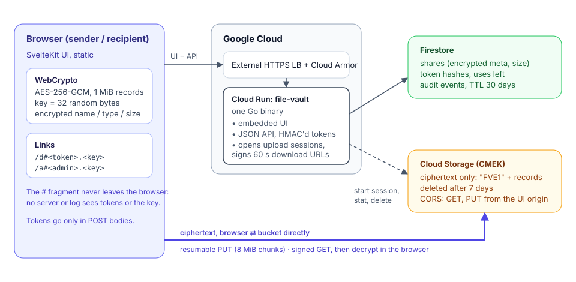

# file-vault

End-to-end encrypted, self-destructing file sharing on Google Cloud. Upload a
file, get two links: a **download link** with configurable expiry and use
count, and an **admin link** to issue more download links, revoke them, or
delete the share.

- **End-to-end encrypted.** The browser encrypts the file (AES-256-GCM,
  chunked) before upload. The server and the bucket only ever hold ciphertext
  and an encrypted name. The key travels in the URL fragment (`#…`), which
  browsers never send to a server.
- **No accounts.** Links are the credentials: `/d#<token>.<key>` and
  `/a#<admin-token>.<key>`. Tokens are 256-bit random, HMAC-hashed at rest,
  and only ever sent in POST bodies, so no request log records one.
- **Preview-safe.** Opening a download link only checks it. A use is consumed
  when the recipient clicks Download, so Slack, Outlook Safe Links or iMessage
  previews can't burn it.
- **Atomic burn** in a Firestore transaction: concurrent clicks on a one-time
  link can't both succeed.
- **Direct-to-storage transfers.** The browser uploads ciphertext straight to
  Cloud Storage through a resumable session the server opens with a fixed
  size, and downloads through a 60-second signed URL. Files up to 1 GiB by
  default; the service never proxies bytes.
- **One service.** A single Go binary serves the UI (SvelteKit, built
  statically and embedded) and the JSON API.

**Documentation: https://bcollard.github.io/file-vault/**



## Layout

```
api/         Go service: JSON API, embedded UI, LOCAL_MODE backends
  cmd/file-vault/      entrypoint
  internal/server/     handlers, client IP, security headers, rate limits
  internal/store/      Firestore + in-memory stores (shared test suite)
  internal/blob/       GCS + local-disk blob backends
  internal/webui/      go:embed of the built UI
web/         SvelteKit 3 + Svelte 5 + Tailwind 4 UI (static, client-only)
  src/lib/crypto.ts    encryption format (documented in the file header)
  src/lib/transfer.ts  chunked upload, streaming download + decrypt
terraform/   GCP infra: app (Cloud Run + NEG), storage, firestore (named DB), secrets, ops
cicd/        WIF bootstrap script
docs/        documentation site (Starlight), published to GitHub Pages
Dockerfile   builds the UI, embeds it, ships one distroless image
```

## How a share works

1. The browser generates a 256-bit key and encrypts the file name, type and
   size with it.
2. `POST /api/shares` with the ciphertext size and encrypted metadata. The
   server opens a GCS resumable session pinned to that size and returns its
   URL plus the admin token.
3. The browser encrypts the file in 1 MiB records and PUTs them to the session
   URL in 8 MiB chunks.
4. `POST /api/shares/finalize` checks the object size, marks the share ready
   and mints the first download token.
5. The recipient opens `/d#<token>.<key>`. The page calls
   `POST /api/download/peek` (no state change) and decrypts the file name.
6. On click, `POST /api/download/burn` decrements the use count and returns a
   signed URL. The browser streams the ciphertext, decrypts it and saves it
   under the original name.

## Local development

No GCP credentials needed. `LOCAL_MODE=1` swaps Firestore and GCS for an
in-memory store and a local directory that speaks the same upload protocol.

```bash
make dev        # Go on :8080 + Vite on :5173 with hot reload → http://localhost:5173
make test       # Go tests (-race) + svelte-check + crypto tests
make e2e        # builds the binary and runs a full upload/download round trip
make build      # → ./bin/file-vault with the UI embedded
```

To run the Go store tests against Firestore too, start the emulator and set
`FIRESTORE_EMULATOR_HOST` before `make api-test`.

## Deploy

Deploys run from GitHub Actions: every push to `main` builds the image and
runs `terraform apply` with it (`.github/workflows/deploy.yaml`). Pull
requests that touch `terraform/` get a plan comment. Nothing
deployment-specific is committed: project, bucket, domain and state bucket
live in GitHub variables and secrets, and locally in gitignored files.

You need a GCP project and an external HTTPS Application Load Balancer.

1. **Bootstrap CI access** (once, as a project owner):

   ```bash
   cp cicd/setup.env.example cicd/setup.env   # PROJECT_ID, GH_REPO_OWNER, GH_REPO_NAME
   bash cicd/setup-gcp-wif.sh
   ```

   It creates the CI service accounts, the Artifact Registry repo and the
   Terraform state bucket, and prints the values for the next step.

2. **Configure GitHub.**

   | Where | Name | Value |
   |---|---|---|
   | Repository variable | `GCP_PROJECT_ID` | your project |
   | Repository variable | `GCP_PROJECT_NUMBER` | printed by the bootstrap |
   | Repository variable | `TF_STATE_BUCKET` | printed by the bootstrap |
   | Repository variable (optional) | `GCP_REGION`, `AR_REPO`, `WIF_POOL`, `WIF_PROVIDER`, `DEPLOY_ENV` | defaults: `europe-west9`, `file-vault`, `gitops-pool`, `gh-provider`, `prod` |
   | Environment `prod`, secret | `TFVARS` | content of your `terraform.tfvars` |

   ```bash
   cp terraform/envs/prod/terraform.tfvars.example terraform/envs/prod/terraform.tfvars
   $EDITOR terraform/envs/prod/terraform.tfvars        # project_id, bucket_name, domain, alert_email
   gh secret set TFVARS --env prod < terraform/envs/prod/terraform.tfvars
   ```

3. **Push to `main`** (or run the Deploy workflow by hand). The job summary
   shows the serverless NEG to attach.

4. **Route your domain** to that NEG on the load balancer and point DNS at it:
   [the load balancer guide](docs/src/content/docs/self-hosting/load-balancer.md).

To run Terraform locally instead:

```bash
cd terraform/envs/prod
cp backend.hcl.example backend.hcl                  # gitignored
terraform init -backend-config=backend.hcl
terraform plan -var image=<region>-docker.pkg.dev/<project>/file-vault/file-vault:<sha>
```

### Configuration

Environment variables on the service (Terraform sets the important ones):

| Variable | Default | Notes |
|---|---|---|
| `PUBLIC_ORIGIN` | — | `https://<domain>`; upload sessions are bound to it |
| `MAX_UPLOAD_MB` | `1024` | Ciphertext limit. Downloads decrypt in browser memory |
| `SHARE_TTL_DAYS` | `7` | Hard lifetime of a share and its object |
| `DEFAULT_TOKEN_TTL_HOURS` / `MIN_` / `MAX_` | `48` / `1` / `168` | Per-link expiry bounds |
| `DEFAULT_MAX_USES` / `MAX_USES_PER_TOKEN` | `1` / `100` | Per-link use bounds |
| `DOWNLOAD_URL_TTL_SECONDS` | `60` | Signed download URL lifetime |
| `AUDIT_RETENTION_DAYS` | `30` | Firestore TTL on audit events (they hold IPs) |
| `TRUSTED_PROXY_HOPS` | `2` | X-Forwarded-For entries added by the Google LB |
| `RATE_LIMIT_UPLOAD_RPM` / `_READ_RPM` | `10` / `60` | Per IP, per instance |

## Security notes

- The server can't decrypt files, but it serves the JavaScript that does the
  encryption. Whoever controls the deployment could ship a modified UI. This
  is the usual limit of browser-based end-to-end encryption.
- The admin link contains the file key: anyone holding it can download the
  file by issuing themselves a link.
- File size is visible to the server (ciphertext length ≈ plaintext + 16 bytes
  per MiB).

## License

MIT — see [LICENSE](LICENSE).
