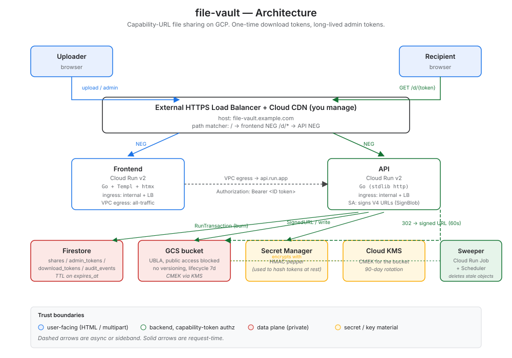

# file-vault

One-time file sharing on Google Cloud. Upload a file, get two URLs: a
**download link** with configurable expiry and use count, and an **admin link**
to issue new download links, revoke them, or delete the share.

- No accounts. Tokens are the auth.
- 256-bit random tokens, HMAC-hashed at rest, atomic burn in a Firestore
  transaction so concurrent clicks can't both succeed.
- Per-upload control: pick how many uses (1 to 100) and how long (1h to 7d)
  the download link should last.
- GET on the download URL renders a confirmation page; the burn happens on
  POST. Slack / Outlook / iMessage link previews can't accidentally consume a
  use.
- Capability URLs only — no Cloud Storage URL ever reaches the recipient until
  after the burn, and the signed URL it does get expires in 60 seconds.
- Downloads always served as `Content-Disposition: attachment` so an uploaded
  HTML file can't execute as a page on `storage.googleapis.com`.



## Layout

```
api/         Go API (Cloud Run): /api/shares, /d/{token}, /api/admin/{token}/*
web/         SvelteKit + Tailwind + shadcn-svelte UI (Cloud Run, adapter-node)
terraform/   GCP infra in modules (storage / firestore / api / web / ops / …)
cicd/        WIF bootstrap script
.github/     GHA workflows: build images, terraform plan on PR, apply on main
docs/        architecture + request-flow SVGs, LB setup instructions
```

## Quickstart

You'll need a GCP project (Cloud Run, Firestore, GCS, Secret Manager, KMS), a
GitHub repository, and Node 22 + Go 1.25 locally (only for builds and dev).

### 1. Bootstrap

```bash
cp cicd/setup.env.example cicd/setup.env
$EDITOR cicd/setup.env            # set PROJECT_ID, GH_REPO_OWNER, GH_REPO_NAME
gcloud auth login                  # as a project owner
bash cicd/setup-gcp-wif.sh
```

The script creates the GHA service accounts, Artifact Registry repo, Terraform
state bucket, and Workload Identity bindings. At the end it prints the GitHub
Actions repository variables to set.

### 2. Configure GHA

In **Settings → Secrets and variables → Actions → Variables**, set:

| Variable | Required? | Notes |
|---|---|---|
| `GCP_PROJECT_ID` | yes | from `cicd/setup.env` |
| `GCP_PROJECT_NUMBER` | yes | printed by the bootstrap script |
| `GCP_REGION` | no | defaults to `europe-west9` |
| `AR_REPO` | no | defaults to `file-vault` |
| `WIF_POOL` | no | defaults to `gitops-pool` |
| `WIF_PROVIDER` | no | defaults to `gh-provider` |

### 3. Wire Terraform

```bash
cp terraform/envs/dev/terraform.tfvars.example terraform/envs/dev/terraform.tfvars
$EDITOR terraform/envs/dev/terraform.tfvars    # project_id, bucket_name, domain, alert_email
$EDITOR terraform/envs/dev/backend.tf          # uncomment, set bucket to the tfstate bucket
```

### 4. Push

```bash
git push origin main
```

The `build-images` workflow pushes container images; once they exist, paste the
tags shown in the workflow's job summary into `terraform.tfvars` and push
again. The `terraform-apply` workflow rolls everything out.

Final step (not automated): wire the two NEGs that Terraform outputs into your
existing external HTTPS Load Balancer. Instructions: [docs/lb-setup.md](docs/lb-setup.md).

## Local preview

```bash
make web-dev
# → http://localhost:5173
```

Runs the SvelteKit UI with stubbed API responses — every screen renders, no GCP
credentials needed. Light/dark mode toggle in the header.

Other Make targets:

```bash
make web-build    # production build of the UI
make web-check    # svelte-check the UI
make api-build    # go build the API
make api-test     # go test the API
make fmt          # gofmt + terraform fmt
```

## Per-upload settings

The upload form has an "Advanced settings" disclosure:

- **Link expires after** — 1 hour to 168 hours (7 days), default 48 hours.
- **Maximum downloads** — 1 (strongest default) up to 20 in the UI, server cap
  100. The link works until the counter hits zero.

The admin console can issue more download links with their own per-link
settings, see real-time usage (`uses_remaining / max_uses`), the IP of the
last download, and revoke or delete the share entirely.

Bounds are configurable via env vars on the Go API:

```
DEFAULT_TOKEN_TTL_HOURS=48
MIN_TOKEN_TTL_HOURS=1
MAX_TOKEN_TTL_HOURS=168
DEFAULT_MAX_USES=1
MAX_USES_PER_TOKEN=100
```

## Documentation

- [docs/architecture.svg](docs/architecture.svg) — components, trust boundaries
- [docs/request-flow.svg](docs/request-flow.svg) — recipient burn sequence
- [docs/lb-setup.md](docs/lb-setup.md) — connecting NEGs to your LB

## License

MIT — see [LICENSE](LICENSE).
