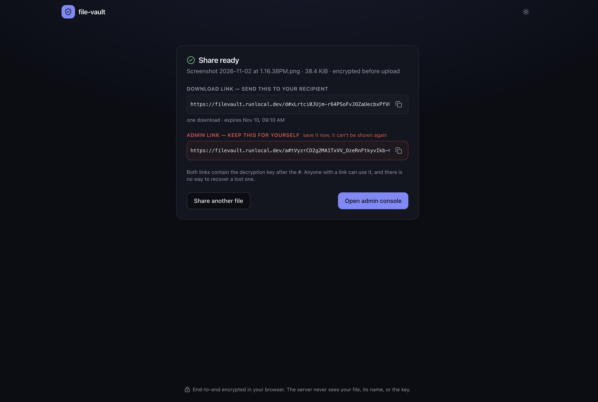
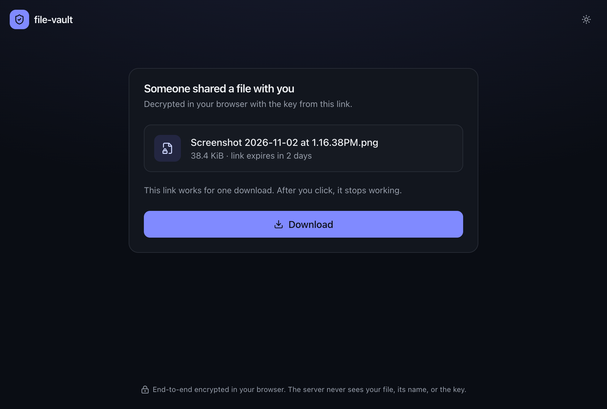
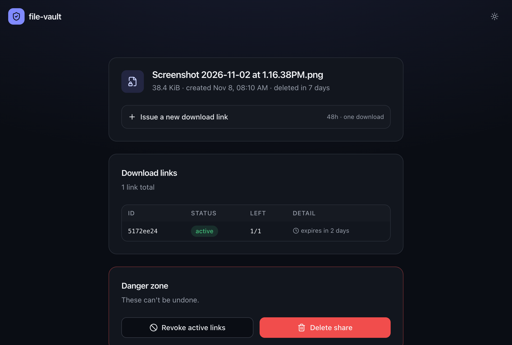

A share has two links:

- the **download link** you send to your recipient: `https://<host>/d#<token>.<key>`
- the **admin link** you keep: `https://<host>/a#<admin-token>.<key>`

Everything after `#` is the URL fragment. Browsers keep the fragment on the client and never send it in an HTTP request, so the server, Cloud Run and the load balancer never see the tokens or the key in a URL.

## Uploading

1. The browser generates a random 256-bit key.
2. It encrypts the file name, type and size with that key. This is the share's metadata.
3. It calls `POST /api/shares` with the ciphertext size, the encrypted metadata, and the link settings (expiry, maximum downloads).
4. The server opens a Cloud Storage resumable upload session pinned to that exact size, stores a pending share in Firestore, and returns the session URL and an admin token.
5. The browser encrypts the file in 1 MiB records and uploads the ciphertext straight to the session URL in 8 MiB chunks. The file never passes through the Go service.
6. The browser calls `POST /api/shares/finalize`. The server checks that the stored object has the declared size, marks the share ready, and creates the first download token.
7. The browser builds both links by appending the token and the key after `#`.

## Downloading

1. The recipient opens the download link. The page reads the token and the key from the fragment.
2. It calls `POST /api/download/peek` with the token. This only checks the token: it doesn't consume a use. The page decrypts the metadata and shows the file name and size.
3. The recipient clicks **Download**. The page calls `POST /api/download/burn`, which decrements the use count in a Firestore transaction and returns a signed Cloud Storage URL valid for 60 seconds.
4. The browser streams the ciphertext from Cloud Storage, decrypts it record by record, checks that nothing was truncated or reordered, and saves the file under its original name.

Link previews (Slack, Outlook Safe Links, iMessage) load the page but never click, so they can't use up a one-time link.

## Managing a share

The admin link opens a console that shows the file name (decrypted with the key from the fragment), every download link with its status and remaining uses, and the IP of the last download. From there you can:

- issue another download link with its own expiry and use count
- revoke every active download link
- delete the share, which removes the encrypted object and every token

## Expiry

| Item | Removed by |
|---|---|
| Download link | its own expiry (1 hour to 7 days), its use count, or revocation |
| Share and encrypted object | Firestore TTL and a bucket lifecycle rule after 7 days, or deletion from the admin console |
| Audit events (hold IPs) | Firestore TTL after 30 days |

Firestore TTL can lag by up to a day, so every lookup also checks the expiry date itself.
