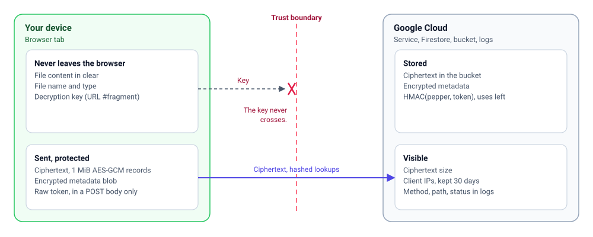

## What the server can and can't see

| Data | Server sees it? |
|---|---|
| File content | No: only AES-256-GCM ciphertext |
| File name and type | No: encrypted in the metadata blob |
| Decryption key | No: it stays in the URL fragment |
| Download and admin tokens | Only as HMAC hashes at rest; raw tokens arrive in POST bodies and are never logged |
| File size | Approximately: ciphertext is the plaintext plus 16 bytes per MiB and a 4-byte header |
| IP of downloads and admin actions | Yes, for the admin console and audit; audit events are deleted after 30 days |

## Links are the credentials

There are no accounts. Whoever holds a link can use it:

- A **download link** allows downloads until it expires, runs out of uses, or is revoked.
- An **admin link** contains the file key. Its holder can read the file name, issue themselves a download link, revoke links and delete the share.

Tokens are 256 random bits. The server stores `HMAC-SHA256(pepper, token)` as the Firestore document ID, so a database leak doesn't yield usable links. The pepper lives in Secret Manager. A lost link can't be recovered; from the admin console you can only issue a new download link.

Unknown, expired, revoked and used-up tokens all return the same `404`, so responses don't reveal whether a token ever existed.

## Keeping tokens out of logs

Every endpoint takes tokens in a JSON POST body. No route has a token in its path or query string, and the service logs only the method, path, status and duration. Because the browser keeps the fragment local, the load balancer and Cloud Run request logs never contain a token or a key. A test fails if a token ever shows up in a log line.

## Link previews

Opening a download link calls a read-only endpoint. A download is counted only after an explicit click. Chat apps and mail scanners that fetch or render links don't consume uses.

## Downloads from the bucket

Signed download URLs are valid for 60 seconds and always force `Content-Disposition: attachment` and `application/octet-stream`, so the bucket never serves anything a browser would render. The bucket has public access prevention enforced, uniform access, and a customer-managed KMS key.

## Abuse limits

- Per-IP rate limits on uploads and reads, counted per Cloud Run instance.
- The client IP is the second-from-right `X-Forwarded-For` entry, the one the Google load balancer adds. The leftmost entries are client-controlled and ignored.
- Cloud Armor on the load balancer is the place for distributed rate limiting.
- Upload size is fixed when the session opens, and finalize rejects an object of any other size.

## Limits of browser-based encryption

- **You trust the deployment.** The server can't decrypt files, but it serves the JavaScript that encrypts them. Whoever controls the deployment could ship a modified UI. This applies to every web app that encrypts in the browser.
- **Anyone with a link can use it.** Anyone who sees a full link, in a chat history, an email archive or a screenshot, can use it while it's valid. Prefer one-time links with short expiry.
- **Downloads decrypt in memory.** The browser holds the decrypted file before saving it, which is why the default upload limit is 1 GiB.
